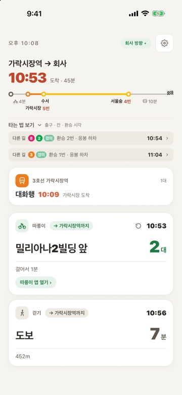
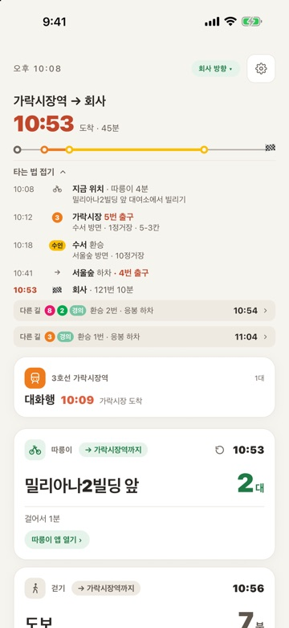

kind: 사용법
hero: ../../../images/blog/mwotaji-bus-or-bike.svg
# 출근길 문 앞에서 — 버스냐 따릉이냐, 도착 시각으로 고르기

아침에 문을 나서며 매번 같은 걸 봅니다. 버스 앱에서 도착 시간, 따릉이 앱에서 남은 자전거, 지도 앱에서 걷는 시간. 뭐타지는 그 셋을 한 화면에 놓고 **목적지에 몇 시에 닿는지**로 나란히 보여 주는 앱입니다.

## 고르는 건 사람, 앱은 숫자만

뭐타지는 "이걸 타세요"라고 하지 않습니다. 비가 오는지, 짐이 있는지, 오늘 걷고 싶은지는 앱이 모르니까요. 대신 지금 위치에서 가능한 길을 카드로 놓고, 카드마다 오른쪽 위에 **도착 예정 시각**을 적습니다. 가장 빠른 길이 무엇인지는 숫자가 말해 주고, 고르는 건 사람이 합니다.

## 화면 보는 법

- **맨 윗줄** — 지하철을 탈 역과 그 뒤 길을 보여 줍니다. 어디서 갈아타는지, 내려서 따릉이 · 버스 중 무엇을 타는지까지요.
- **카드** — 직행 버스 · 버스 · 버스 환승 · 따릉이 · 걷기. 오른쪽 위 시각이 목적지에 닿는 시각입니다.
- **지도** — 카드를 누르면 타는 곳까지 걷는 길이 나옵니다. 지도를 누르면 크게 보이고, 두 손가락으로 확대할 수 있습니다.

## 처음에 할 일은 하나 — 집과 회사

설정에서 집과 회사를 등록합니다. 상호명이나 주소로 찾아도 되고, 그 자리에 서서 「지금 서 있는 자리」로 잡아도 됩니다.

그다음부터는 방향을 고를 필요가 없습니다.

- 집 근처에 있으면 **회사 방향**으로 보여 줍니다.
- 회사 근처에 있고 오후면 **집 방향**으로 바뀝니다.
- 다른 곳에 갈 때는 오른쪽 위 「회사 방향 ▾」를 눌러 집 · 회사 · 저장해 둔 다른 목적지로 바꿉니다.

## 숫자는 어디서 오나

버스 도착과 따릉이 대여소의 남은 자전거, 지하철 도착은 서울시와 공공데이터포털의 실시간 정보입니다. 다만 **타고 가는 시간**과 갈아탈 버스를 기다리는 시간은 거리와 배차 간격으로 어림한 값입니다. 그래서 도착 시각은 "대략 이쯤"으로 봐 주세요. 길이 막히는 날에는 버스 쪽이 더 늦어질 수 있습니다.

## 서울에서 씁니다

따릉이와 서울 버스 정보를 쓰기 때문에 서울에서 출퇴근하는 분께 맞는 앱입니다. 가입과 광고가 없고, 아이폰과 애플워치에서 씁니다. 안드로이드는 테스트 중입니다.

## 함께 보기

- [도움말 — 화면 보는 법과 자주 묻는 것](../support.html)
