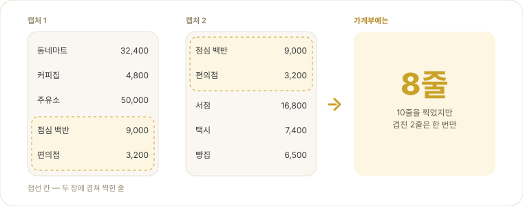
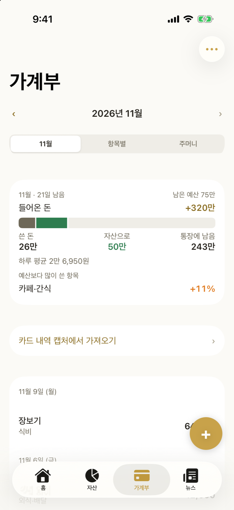
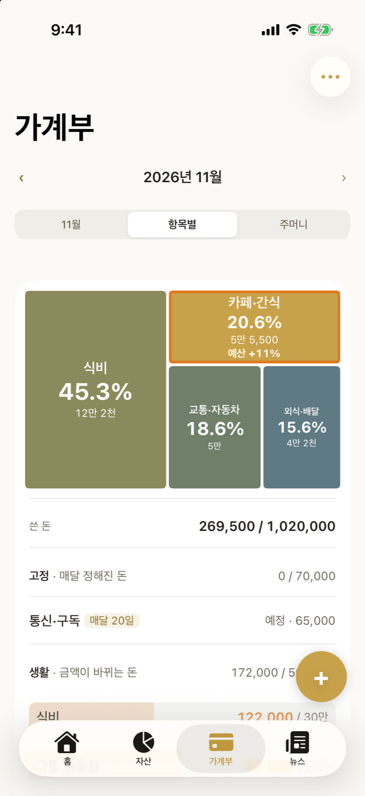

kind: 사용법
hero: ../images/blog/card-capture-hero.svg
# 카드 내역 캡처로 가계부 쓰기 — 연동 없이, 일주일에 5분

가계부를 그만두는 이유는 대개 하나입니다. 적는 게 귀찮아서요. 그래서 골고루 가계부는 카드사 앱의 이용내역 화면을 캡처해 한꺼번에 채우도록 만들었습니다. 은행 · 카드사 계정은 연결하지 않습니다.

## 왜 연동이 아니라 캡처인가

자동으로 긁어 오는 가계부가 편한 건 압니다. 그런데 그러려면 카드사 · 은행 계정을 앱에 맡겨야 하고, 내 결제 내역이 누군가의 서버를 거칩니다. 골고루는 처음부터 **자산 데이터를 기기 밖으로 내보내지 않는다**는 원칙으로 만든 앱이라, 가계부만 예외로 둘 수는 없었습니다.

그래서 고른 것이 캡처입니다. 어차피 카드사 앱에는 이용내역이 날짜순으로 정리돼 있으니, 그 화면을 사진으로 찍어 읽으면 됩니다.

- 글자는 **기기 안에서** 읽습니다. 아이폰 · 아이패드 · 맥은 Apple Vision, 안드로이드는 기기에 들어 있는 ML Kit 입니다.
- 캡처한 이미지는 어디로도 보내지 않고, 앱에 저장하지도 않습니다.
- 가계부 기록은 기기와 내 iCloud(안드로이드는 켠 경우에만 내 구글 드라이브)에만 있습니다.

## 하는 방법

1. 카드사 앱에서 **이용내역** 화면을 엽니다. 길면 내려 가며 여러 장 캡처합니다.
2. 골고루 가계부 탭에서 **「카드 내역 캡처에서 가져오기」**를 누르고 방금 찍은 사진을 고릅니다. 맥에서는 파일을 고르거나 붙여넣어도 됩니다.
3. 읽은 줄이 목록으로 나옵니다. 날짜 · 가맹점 · 금액을 확인하고, 뺄 줄은 끄고, 항목이 틀린 줄은 바꿉니다.
4. **「N개 저장」**을 누르면 끝입니다.

## 여러 장을 찍어도 겹치지 않습니다

캡처로 가계부를 채울 때 제일 신경 쓰이는 게 중복입니다. 화면을 내리며 찍다 보면 앞 장 끝과 다음 장 처음이 겹치니까요. 이 부분은 앱이 알아서 걸러 줍니다.

- 여러 장이면 날짜가 다음 장으로 이어지고, **겹쳐 찍힌 줄은 한 번만** 셉니다.
- 같은 날 · 같은 금액으로 **이미 적어 둔 줄은 꺼진 채로** 나옵니다. 지난주에 가져온 내역을 또 찍어도 두 번 들어가지 않습니다.

그래서 "어디까지 찍었더라"를 기억할 필요가 없습니다. 넉넉하게 찍고, 꺼져 있는 줄은 그대로 두면 됩니다.

## 알아 둘 점 하나 — 취소 내역

카드사 앱이 결제 취소를 금액 앞 − 부호 없이 「취소」 글자로만 표시하는 경우가 있습니다. 이런 줄은 지출로 읽힐 수 있으니, 목록에서 그 줄을 꺼 주세요. 저장하기 전에 목록을 한 번 훑어보는 이유이기도 합니다.

## 제가 권하는 주기 — 일주일에 한 번

매일 적으려고 하면 며칠 못 갑니다. 반대로 한 달을 몰아서 하면 캡처가 너무 많아지고, 무엇을 샀는지 기억도 안 납니다.

- **일주일에 한 번**, 카드사 앱에서 지난 일주일 치를 두세 장 찍어 가져옵니다.
- 현금이나 계좌이체로 쓴 돈만 그때그때 **「+」**로 적습니다. 메모를 치면 지난번에 같은 메모로 고른 항목이 미리 골라져 있습니다.
- 월세 · 통신비 · 구독료처럼 정해진 돈은 **반복**으로 걸어 두면 알아서 들어옵니다.

이렇게 하면 한 주에 5분 안쪽입니다.

## 적고 나면 보이는 것

기록이 쌓이면 가계부 탭 맨 위 카드에서 이번 달 **남은 예산**과, 들어온 돈이 **쓴 돈 · 자산으로 보낸 돈 · 통장에 남은 돈**으로 어떻게 나뉘었는지를 봅니다. 적금 · 연금 · 증권 계좌로 보낸 돈은 지출이 아니라 「자산으로」로 따로 적히기 때문에, "이번 달 얼마나 썼나"와 "얼마나 모았나"가 섞이지 않습니다.

항목별 화면에서는 어디에 많이 썼는지가 칸 크기로 보이고, 예산을 넘긴 항목은 주황 테두리로 표시됩니다.

## 다른 가계부에서 넘어온다면

쓰던 가계부 앱이 CSV 내보내기를 지원하면, 그 파일을 골고루에서 그대로 가져올 수 있습니다(설정 › 가계부 › CSV 가져오기). 날짜 · 금액 · 메모 칸은 앱이 짐작해 맞추고, 틀리면 바꿀 수 있습니다.

## 함께 보기

- [가계부 안내 — 예산 · 반복 · 주머니](../docs/budget.html)
- [개인정보처리방침 — 가계부 기록이 있는 곳](../docs/privacy.html)
