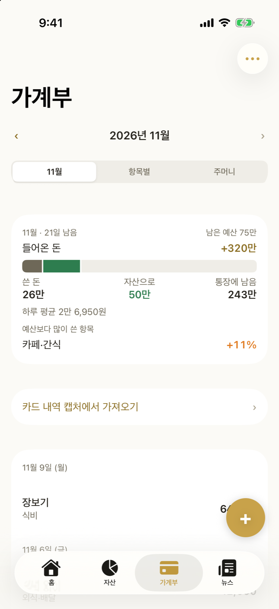
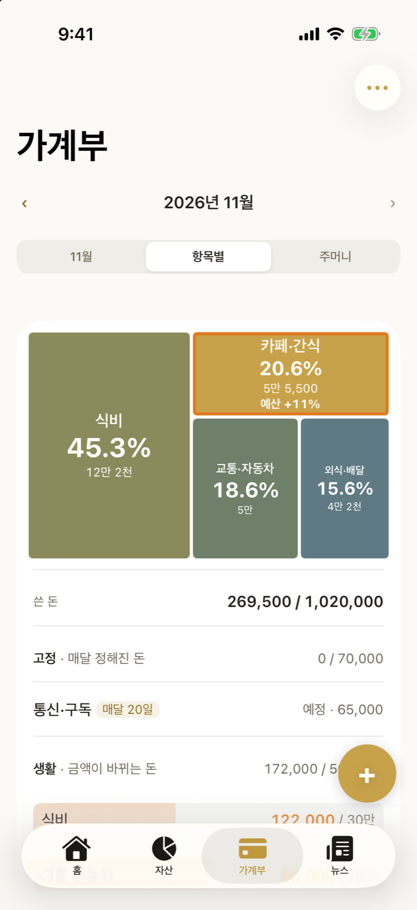

kind: 가계부
hero: ../images/blog/saving-is-not-spending.svg
# 저축은 지출이 아니다 — 「자산으로」를 따로 적는 가계부

가계부에 적금 50만 원을 「지출」로 적으면, 그 달은 돈을 많이 쓴 달이 됩니다. 실제로는 모은 건데요. 골고루 가계부는 그래서 기록을 지출 · 수입 · **자산으로** 셋으로 나눕니다.

## 쓴 돈과 모은 돈이 섞이면 생기는 일

대부분의 가계부는 돈이 통장에서 나가면 지출입니다. 적금 이체도, 연금저축 납입도, 증권 계좌로 보낸 돈도 전부 지출 칸에 쌓입니다. 그러면 두 가지가 안 보입니다.

- **이번 달 정말 얼마를 썼는지.** 저축을 많이 한 달일수록 지출이 커 보입니다.
- **이번 달 얼마를 모았는지.** 지출 속에 묻혀서 따로 더해 봐야 압니다.

「저축」이라는 지출 항목을 만들어 구분하는 방법도 있지만, 합계에서는 여전히 한 덩어리입니다.

## 골고루는 셋으로 나눕니다

기록할 때 맨 위에서 셋 중 하나를 고릅니다.

| 구분 | 무엇을 적나 |
| --- | --- |
| 지출 | 써서 없어진 돈 — 식비, 교통, 월세 |
| 수입 | 들어온 돈 — 월급, 이자 |
| 자산으로 | 적금 · 연금 · 증권 계좌처럼 **내 자산으로 옮긴 돈** |

그리고 가계부 탭 맨 위 카드가 한 달을 이렇게 보여 줍니다. 들어온 돈이 **쓴 돈 · 자산으로 보낸 돈 · 통장에 남은 돈**으로 어떻게 나뉘었는지 막대 하나로요.

## 이렇게 적으면 보이는 것

- **쓴 돈**은 진짜 소비만 남습니다. 예산과 견줄 때 저축 때문에 넘쳐 보이지 않습니다.
- **자산으로**는 그 달에 모은 돈입니다. 들어온 돈에서 차지하는 비중이 곧 그 달의 저축률입니다.
- **통장에 남은 돈**은 쓰지도 모으지도 않은 돈입니다. 여기가 매달 크다면 더 모을 여지가 있다는 뜻입니다.

## 계획한 저축은 반복으로

매달 같은 날 나가는 적금 · 연금 납입은 「자산으로」 기록에 **반복(매달)**을 걸어 두면 됩니다. 항목별 화면의 「자산으로」 칸에서 보낸 돈과 계획이 나란히 보이고, 반복이 걸린 줄은 「예정」으로 표시됩니다. 이번 달에 아직 안 보낸 저축이 무엇인지 한눈에 봅니다.

## 자산 화면과 같이 보면

골고루는 원래 자산을 보는 앱입니다. 가계부에서 「자산으로」 보낸 돈이 쌓이는 곳이 자산 탭의 계좌들이고요. 한쪽에서는 **이번 달 얼마를 보냈는지**, 다른 쪽에서는 **그 돈이 지금 얼마가 됐는지**를 봅니다. 가계부와 자산관리를 한 앱에 둔 이유입니다.

## 함께 보기

- [가계부 안내 — 예산 · 반복 · 주머니](../docs/budget.html)
- [카드 내역 캡처로 가계부 쓰기](card-capture-budget.html)
