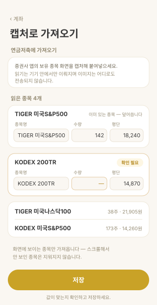
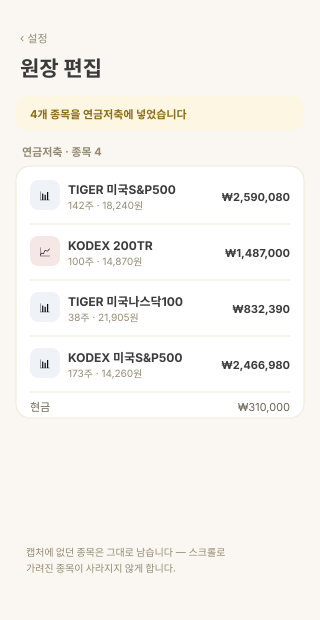

kind: 사용법
hero: ../images/blog/holdings-from-screenshot.svg
# 증권사 화면 캡처로 보유 종목 채우기 — 하나씩 치지 않아도 됩니다

자산관리 앱을 깔고 가장 먼저 막히는 곳이 입력입니다. 종목이 열 개만 돼도 이름 · 수량 · 평단을 서른 칸 쳐야 하니까요. 골고루는 증권사 앱 화면을 캡처해 붙여넣으면 그 칸을 읽어서 채웁니다.

## 증권사 연결 없이, 어느 증권사든

증권사 계정을 연결하거나 API 키를 넣을 필요가 없습니다. 화면에 보이는 글자를 읽는 방식이라 **어느 증권사 앱이든** 됩니다.

- 읽는 것은 **종목명 · 수량 · 매입단가**입니다.
- 읽기는 기기 안에서만 이뤄지고, 이미지는 어디로도 보내지 않습니다.
- 평가액 · 수익률 · 비중은 적지 않습니다. 시세가 붙으면 앱이 계산합니다.

## 하는 방법

1. 증권사 앱에서 **보유 종목 목록**이 보이는 화면을 캡처합니다.
2. 골고루에서 오른쪽 위 **⋯ › 편집**을 열고, 채울 계좌를 누른 뒤 **캡처로 가져오기**를 엽니다.
3. **붙여넣기**를 누르면 읽은 종목이 목록으로 나옵니다.
4. 수량과 평단을 확인하고 저장합니다.

맥에서 `⌘ ⇧ 4` 로 찍으면 클립보드가 아니라 파일로 저장됩니다. 그때는 **파일에서 고르기**로 그 이미지를 고르면 됩니다.

## 저장 전에 볼 두 가지

- **「확인 필요」가 붙은 줄.** 글자가 흐리거나 잘려서 확신이 없는 줄입니다. 수량과 평단을 증권사 화면과 한 번 견줘 보세요.
- **이미 있는 종목.** 그 계좌에 같은 종목이 있으면 새 값으로 덮어씁니다. 매수한 뒤 다시 캡처해 가져오면 수량과 평단이 갱신되는 식입니다.

## 아직 계좌가 없다면

처음이라면 계좌부터 만듭니다. 홈 맨 위 「예시 자산으로 보는 중」 띠의 **내 자산 넣기**를 누르고, 계좌 이름(예: 연금저축, 증권계좌)을 쳐서 추가하면 됩니다. 그다음 위 순서대로 캡처를 가져옵니다.

목표 비중을 정하기 어려우면 처음 화면에서 **목표 비중 견본**을 골라 시작할 수도 있습니다. 견본은 예시이며 투자 권유가 아닙니다.

## 채우고 나면

종목마다 시세가 자동으로 붙고, 계좌별 · 자산군별 비중과 목표와의 차이가 계산됩니다. 여기서부터가 골고루가 하려는 일입니다 — 흩어진 계좌를 한 화면에 모으고, 목표에서 얼마나 벌어졌는지 보는 것.

## 함께 보기

- [시작하기](../docs/getting-started.html)
- [조정안 — 목표와의 차이](../docs/allocation-rebalancing.html)
