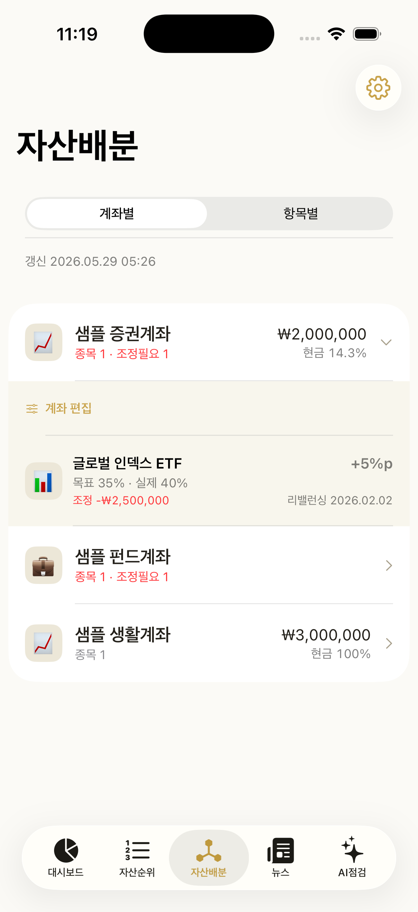
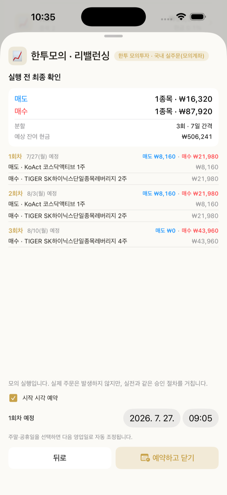

kind: 사용법
hero: ../images/blog/monthly-deposit-split.svg
# 이번 달 50만 원, 어디에 넣지 — 팔지 않고 비중 맞추기

연금저축이나 ISA에 매달 돈을 넣는 분이라면 월급날마다 같은 질문을 합니다. 이번 달 넣은 돈으로 무엇을 몇 주 살까. 골고루의 **이번 달 넣을 돈 나누기**가 그 계산을 합니다.

## 새 돈으로 모자란 쪽을 채운다

목표 비중을 정해 두어도 시간이 지나면 오른 종목은 커지고 내린 종목은 작아집니다. 이걸 되돌리는 방법은 둘입니다.

- 많아진 종목을 **팔아서** 적어진 종목을 산다.
- **새로 넣는 돈**으로 적어진 종목만 산다.

매달 적립하는 계좌라면 두 번째가 쉽습니다. 팔 것이 없으니 거래가 한 방향이고, 계산도 단순합니다.

## 손으로 하면 이렇습니다

예시입니다. 목표가 주식 ETF 60% · 채권 ETF 40%인 계좌에 지금 주식 660만 원 · 채권 340만 원이 있고, 이번 달 50만 원을 넣습니다.

1. 넣은 뒤 총액은 1,050만 원입니다.
2. 목표 금액은 주식 630만 원 · 채권 420만 원입니다.
3. 주식은 이미 660만 원이라 살 것이 없고, 채권이 80만 원 모자랍니다.
4. 넣을 돈은 50만 원이니 **전부 채권에** 넣습니다.

종목이 서너 개가 되고, 한 주 가격이 제각각이면 이 계산이 금방 번거로워집니다.

## 앱에서는

홈의 **이번 달 넣을 돈 나누기**를 누르고 계좌와 금액을 넣습니다. (목표 비중을 넣은 계좌가 있어야 홈에 카드가 보입니다.)

- 새 돈을 더한 총액을 기준으로 **모자란 종목부터 몇 주씩** 살지 나옵니다. 팔지 않습니다.
- 종목마다 **지금 비중 → 산 뒤 비중**과 목표가 같이 보입니다.
- 주수로 나누고 남는 돈은 현금으로 둡니다.
- 이미 목표에 딱 맞는 계좌라면 새 돈을 목표 비율대로 나눕니다.

## 사고 난 뒤

**골고루는 주문을 넣지 않습니다.** 나온 주수대로 증권사 앱에서 직접 삽니다. 산 뒤 **「샀어요 — 보유에 반영」**을 누르면 그 주수가 보유에 더해지고(평단은 가중평균으로), 남은 돈은 그 계좌의 현금이 됩니다.

## 잊지 않게

**매달 적립일에 알림**을 켜고 날짜를 고르면 그날 아침 9시에 알려 줍니다. 월급날 다음 날로 맞춰 두면, 알림을 누르고 금액을 넣고 증권사 앱에서 사는 데까지 10분이면 됩니다.

## 차이가 너무 클 때는

새 돈으로 메우기에는 차이가 너무 벌어졌다면 일부를 팔아 옮기는 리밸런싱이 필요합니다. 그건 조정안의 리밸런싱 계획에서 다룹니다.

이 글의 비중과 금액은 계산을 보이기 위한 예시이며 투자 권유가 아닙니다.

## 함께 보기

- [조정안 — 이번 달 넣을 돈 나누기](../docs/allocation-rebalancing.html)
- [연금저축 ETF 리밸런싱 — 언제, 얼마나](../docs/guide-pension-rebalancing.html)
