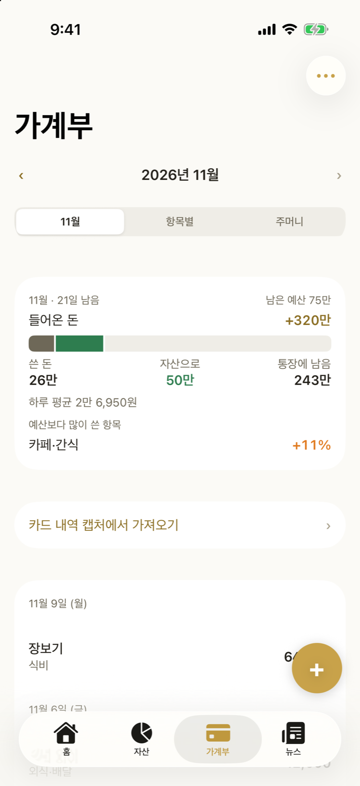
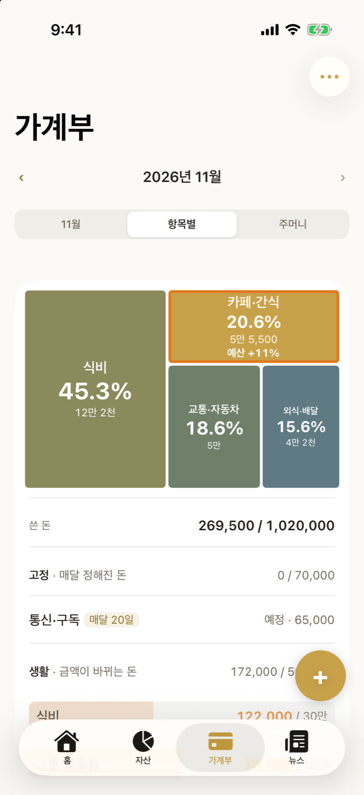

kind: 가계부
hero: ../images/blog/fixed-and-living-budget.svg
# 고정비와 생활비를 나눠 예산 세우기

예산을 세울 때 식비와 월세를 같은 줄에 놓으면 곤란해집니다. 월세는 아낄 수 없고 식비는 아낄 수 있으니까요. 골고루 가계부는 지출 항목을 **묶음**으로 나눠서, 줄일 수 있는 돈과 없는 돈을 따로 봅니다.

## 묶음 넷

설정 › 가계부 › **항목 · 예산**에서 지출 항목마다 묶음을 정합니다.

| 묶음 | 어떤 돈 | 예 |
| --- | --- | --- |
| 고정 | 매달 정해진 돈 | 월세, 관리비, 통신비, 보험료 |
| 생활 | 매달 나가지만 금액이 바뀌는 돈 | 식비, 교통, 생활용품 |
| 선택 | 안 써도 되는 돈 | 외식, 취미, 쇼핑 |
| 가끔 | 드물게 크게 나가는 돈 | 경조사, 여행, 수리 |

항목 이름과 묶음, 월 예산은 모두 고칠 수 있고, 안 쓰는 항목은 숨기면 됩니다.

## 예산은 묶음별로 다르게 세웁니다

- **고정**은 예산이라기보다 확인입니다. 실제 나가는 금액을 그대로 적고, 반복 기록을 걸어 둡니다. 여기를 줄이려면 요금제를 바꾸거나 이사를 해야 하니, 매달 들여다볼 필요가 없습니다.
- **생활**이 진짜 예산입니다. 지난 몇 달 평균을 보고 조금 낮게 잡습니다. 항목을 누르면 **지난 6달 막대**가 나오니 평균을 가늠하기 쉽습니다.
- **선택**은 한도입니다. 이만큼까지는 마음 편히 쓴다는 금액을 정합니다.
- **가끔**은 달마다 들쭉날쭉해서 월 예산으로 보기 어렵습니다. 이런 돈은 [주머니](pockets.html)로 따로 모으는 편이 맞습니다.

## 한 달 동안 보는 화면

- 가계부 탭 맨 위 카드에 **남은 예산**과 이번 달 남은 날이 나옵니다. 하루 평균 쓴 돈도 같이 보입니다.
- **예산보다 많이 쓴 항목**은 얼마나 넘었는지와 함께 따로 표시됩니다.
- 항목별 화면에서는 쓴 돈이 항목 블록으로 보입니다. 칸 크기가 비중이고, **예산을 넘긴 항목은 주황 테두리**입니다.
- 그 아래에 고정 · 생활 묶음마다 「쓴 돈 / 예산」이 적힙니다.

## 처음 세울 때 순서

1. 한 달은 예산 없이 **기록만** 합니다. 카드 내역 캡처로 몰아서 넣어도 됩니다.
2. 항목별 화면에서 어디에 얼마가 나갔는지 봅니다.
3. 고정 항목에 실제 금액을 예산으로 넣고 반복을 겁니다.
4. 생활 · 선택 항목에 지난달보다 조금 낮은 금액을 넣습니다.
5. 다음 달부터는 주황 테두리가 뜬 항목만 봅니다.

처음부터 빡빡하게 잡으면 첫 주에 넘기고 그만두게 됩니다. 지킬 수 있는 숫자에서 시작해 조금씩 내리는 편이 오래갑니다.

## 함께 보기

- [가계부 안내 — 항목 · 예산](../docs/budget.html)
- [카드 내역 캡처로 가계부 쓰기](card-capture-budget.html)
