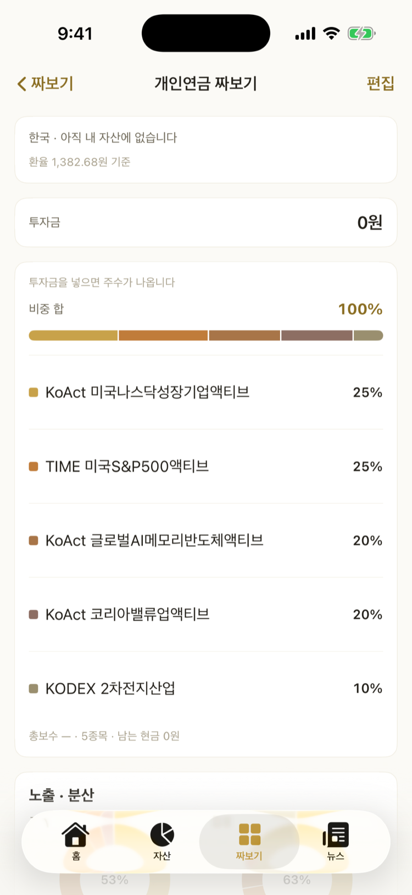

kind: 기능 소개
hero: ../images/blog/draft-before-buying.svg
# 사기 전에 ETF 조합을 짜 보기

"나스닥100을 담자"까지 정해도 고를 것이 남습니다. 운용사마다 같은 지수를 따르는 ETF가 있고, 환헤지 판과 커버드콜 판까지 붙어 있으니까요. 골고루의 **짜보기**는 사기 전에 그것들을 한자리에 놓고 견줘 보는 곳입니다.

## 아직 내 자산이 아닌 구성

짜보기에서 만든 조합은 실제 자산이 아닙니다. 「내 자산에 넣기」를 누르기 전까지는 화면에 **아직 내 자산에 없습니다**라고 붙어 있고, 자산 합계에도 들어가지 않습니다. 마음 놓고 이리저리 바꿔 봐도 됩니다.

## 순서

1. **새로 짜보기**를 누르고 이름과 시장(한국 · 미국 · 둘 다)을 정합니다. 시장은 만든 뒤에 바꿀 수 없습니다.
2. **종목 담기**로 종목을 찾습니다. ETF와 개별 종목이 칸으로 나뉘어 있습니다.
3. 후보를 최대 다섯 개까지 골라 **비교**합니다.
4. 담을 것을 정하고 비중을 넣습니다.

종목은 나중에 몇 번이든 더 얹을 수 있습니다. 나스닥100을 먼저 담고, 다음 날 채권과 배당을 더하는 식으로요.

## 찾을 때 — 운용사별로 묶어서

ETF 칸에서는 후보를 **운용사별로 묶어** 보여 줍니다. 같은 지수를 따르는 ETF를 찾을 때 이름이 비슷비슷해 헷갈리는데, 묶여 있으면 한눈에 들어옵니다. 이름에서 유형도 뽑아 배지로 답니다.

| 배지 | 뜻 |
| --- | --- |
| 환헤지 | 환율 변동을 상쇄하는 판 |
| 커버드콜 | 콜옵션을 팔아 분배금을 늘린 판 |
| 레버리지 · 인버스 | 지수의 배수 · 반대 방향 |
| 월배당 | 분배금을 다달이 주는 판 |
| TR | 분배금을 재투자하는 판 |

## 비교할 때 — 나란히

고른 후보를 표로 나란히 놓습니다. 항목이 행이고 ETF가 열입니다. 아이폰에서는 옆으로 밀어서 보고, 맥과 아이패드에서는 한 번에 보입니다.

## 조합이 되면 보이는 것

내 조합 목록에서는 조합마다 비중 띠와 함께 **시장 · 예상 배당 · 총보수 · 종목 수**가 한 줄로 붙습니다. 같은 구성을 환헤지 판으로도 보고 싶으면 **복제**해서 종목만 바꿔 보면 됩니다.

이 계산은 전부 앱 안에서 합니다. 밖으로 나가는 것은 종목을 찾고 시세를 받을 때의 검색어와 종목 심볼뿐입니다.

## 마음에 들면

**내 자산에 넣기**를 누르면 같은 이름의 계좌가 생기고, 그 비중이 목표 비중으로 걸립니다. 그때부터는 자산 탭에서 목표와 실제의 차이를 봅니다.

남들은 어떻게 짰는지 궁금하면 옆 칸 **나눔터**에서 다른 사용자가 올린 조합을 보고, 마음에 드는 것을 내 조합으로 가져올 수 있습니다. 나눔터의 조합은 사용자가 올린 것이며 투자 권유가 아닙니다.

## 함께 보기

- [짜보기 · 나눔터 안내](../docs/portfolio-draft.html)
- [ETF 조합 모음](../c/d/)
