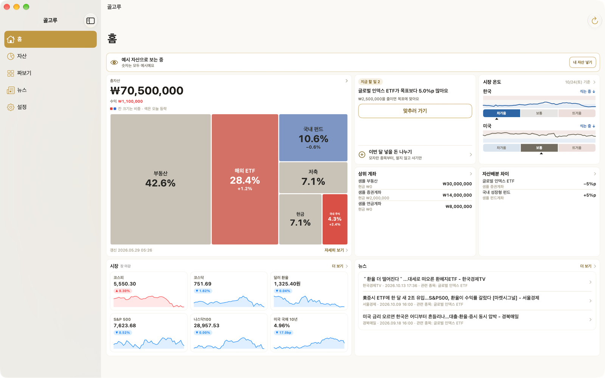

# 홈

> **지원 방식:** 둘러보기 · 내 자산 넣기

앱을 열면 가장 먼저 보이는 화면입니다. 내 돈이 지금 어떤 상태인지를 몇 초 안에
읽는 것이 목표입니다. 목록은 각자의 탭에 하나씩만 두고, 여기에는 두지 않습니다.

## 화면 구성

1. **총자산** — 금액, 오늘 변동, 지금까지의 수익을 한 카드에.
   금액은 기본으로 보이고, 가리고 싶으면 설정 > 앱 > **금액 가리기**를 켭니다.
   켜면 흐려지고 길게 누르는 동안만 보입니다.
2. **자산 구성 트리맵** — 종류마다 비중만큼의 블록(3.6.0부터). **칸 색은 오늘 등락**입니다 — 오르면 빨강 · 내리면 파랑,
   많이 움직일수록 진하고, 매일 시세가 없는 부동산 · 저축 · 현금은 베이지 회색. 기록이 한 달 쌓이면 「오늘 | 한 달」을 고를 수 있고,
   한 달 보기에는 비중이 얼마나 바뀌었는지(%p)도 적습니다. 자산이 한 종류뿐이면(전부 ETF 등) 종류 대신 **종목별** 블록으로 나눕니다(3.7.1부터). 블록이나 **자세히 보기**를 누르면 [구성 리포트](portfolio-analysis.md)로 들어갑니다.
3. **시장 온도** — 한국 · 미국 시장이 지금 차가운지 · 보통인지 · 뜨거운지(3.5.0부터). 누르면 지표별 흐름과
   내 자산이 그때 어떻게 움직였는지를 같이 봅니다([시장 온도](market-temperature.md)).
4. **지금 할 일** — 목표 비중과 기준(기본 5%p) 이상 벌어진 항목이 있을 때만 나옵니다.
   **맞추러 가기**를 누르면 [조정안](allocation-rebalancing.md)이 열립니다.
   **조정할 것이 없으면 이 카드는 아예 나오지 않습니다.**
5. **시장** — 세 칸입니다. 달러 환율은 늘 자리를 지키고, 앞 두 칸은 지금 열려 있는
   장을 따라갑니다 — 국내장이면 코스피 · 코스닥, 미국장이면 나스닥100 · S&P 500.
   **더 보기**를 누르면 국채 금리 · 유가를 포함한 열한 종을 다 봅니다.
   맥 · 아이패드는 두 줄 — 다른 장의 지수 둘과 미국 국채 10년을 더하고, 칸마다 미니 차트를 그립니다(3.7.0부터).
6. **뉴스** — 최근 기사 제목 두 줄(맥 · 아이패드는 셋). 누르면 바로 읽고, **더 보기**로 [뉴스 탭](news-reports.md)에 갑니다.

계좌 목록과 자산배분 차이 목록은 [자산 탭](asset-ranking.md)에 있습니다.
첫 화면에 같은 목록을 한 번 더 두지 않습니다.

## 맥 · 아이패드에서는

화면이 넓으면 큰 총자산 옆에 **지금 할 일 · 시장 온도 · 상위 계좌 · 자산배분 차이**를 네모 칸으로 놓고,
아래에 시장(두 줄 · 미니 차트)과 뉴스(셋)를 나란히 둡니다. 한 화면에 여러 개를 놓고 보는 기계라서, 탭을 오가는
비용이 폰보다 큽니다.

## 홈 화면 위젯

> 3.1.0부터 iPhone · iPad · Android, 3.2.0부터 맥에서도 쓸 수 있습니다. 보여줄 것 고르기는 3.7.0부터.

위젯을 길게 눌러 **위젯 편집**(Android는 위젯을 놓을 때 · 다시 길게 눌러 설정)에서 보여줄 것을 고릅니다.

| 보여줄 것 | 무엇이 나오나 |
| --- | --- |
| **자동**(기본) | 평소엔 자산 구성, 리밸런싱 회차 · 적립일이 다가오면 다음 할 일 |
| **자산 구성** | 홈 트리맵과 같은 비중 블록 — 칸 크기는 비중, 색은 오늘 등락. 언제 값인지(「15:30 기준」)를 같이 적습니다 |
| **시장 온도** | 한국 · 미국이 차가움 · 보통 · 뜨거움 중 어디인지, 막대 아래 삼각형으로 지금 자리, 식는 중 · 뜨거워지는 중 |
| **다음 할 일** | 아래 순서로 해당하는 첫 번째 |

### 다음 할 일

위에 있는 것부터 보고, 해당하는 첫 번째를 보여 줍니다.

1. **리밸런싱 회차** — 나눠서 하는 리밸런싱의 다음 회차까지 남은 날(**D-4** · **오늘**)과 사고팔 종목 수.
   증권사에 걸어 둔 예약이 있으면 그 예약이 나가는 날이 먼저 나옵니다. 기다리는 계좌가 여럿이면 날짜가 가까운
   계좌를 크게, 나머지는 「외 N」과 계좌별 예정일로 함께 보여 줍니다.
2. **적립일** — [넣을 돈 나누기](allocation-rebalancing.html) 알림을 켰으면 적립일 이레 전부터 남은 날을 셉니다.
3. **목표와 가장 벌어진 종목** — 둘 다 없으면 그 차이(%p)와 목표 막대(금색이 지금, 진한 눈금이 목표).

누르면 그 일을 하는 화면이 바로 열립니다 — 리밸런싱 진행 · 넣을 돈 나누기 · 그 계좌. 작은 크기 · 중간 크기가 있고,
중간 크기는 오른쪽에 사고팔 종목이나 계좌별 예정일을 적습니다.

- **금액 · 수량은 나오지 않습니다.** 홈 화면은 옆 사람도 보기 때문에 이름 · 비중 · 등락 · 날짜만 씁니다.
- 위젯은 스스로 인터넷에 접속하지 않습니다. 앱을 열 때 바뀐 내용으로 다시 그리고, 남은 날은 자정마다 스스로 줄입니다.
- 추가하는 법: 홈 화면을 길게 누르고 **위젯 추가**(Android는 **위젯**, 맥은 바탕화면을 오른쪽 클릭 › **위젯 편집**)에서 골고루를 고릅니다.

## 알아두면 좋은 것

- 달러 자산의 원화 환산은 시장지표의 USD/KRW 값으로 **앱 안에서만** 계산합니다.
- 아래로 당기면 시세 · 자산 · 뉴스를 한 번에 새로고침합니다.
  맥 · 아이패드는 오른쪽 위 새로고침 버튼입니다.
- 화면 모드(시스템 · 라이트 · 다크)와 글자 크기는 설정 > 앱에서 고릅니다.
