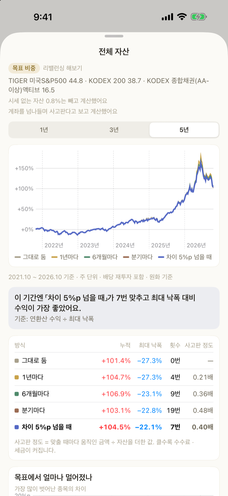

# Adjustment plan

> **Works with:** the sample · your own assets
> (editing target weights only when you enter your own assets)

Works out the gap between your target weights and what you actually hold, and shows only
**what to move and how much**. You get there from the “adjustment plan” row on the
[Assets](asset-ranking.md) screen, or “see the adjustment plan” in an account.

## What you see

One card per class. On the bar, **the dark tick is the target and the filled colour is where you are**.

- Above the target it says **trim**; below it, **add** — with the amount.
- The target and current figures **carry amounts** — `Target 35% · ₩17.5M` / `Now 40% · ₩20M`.
  With percentages alone, nothing on screen says 35% of what.
- **Classes inside the range fold into one line** — `Cash target 10% · ₩5M · same as now`.
- The order is fixed, biggest gap first. There is no sort to choose.
- Tapping an adjustment row opens **that holding's screen** — deciding how much to trim means
  looking at today's price.

## One threshold, in one place

**The threshold lives at Settings &gt; Data &gt; Adjust when off by**, and nowhere else.
The `pp` badge on the Assets screen and the list here use **the same value**.
Set per screen, you end up with “three need adjusting but nothing is marked”.

## One account at a time

Coming in from an account shows **only that account**. Tapping into your brokerage account and
being told about your fund account breaks the thread. Inside an account the holding is pinned down,
so it goes as far as **share counts** — `about 2.5 of 12 shares`. **See the full plan** at the bottom
widens it again.

## After you trade

**The app does not place orders.** Update the **quantity and average cost in account editing** to match
what you bought or sold in your brokerage app. The plan recalculates the moment you do.

## Editing target weights

When you **enter your own assets**, the **account editing** screen changes quantity, average cost,
target weight and cash balance in one place. Open it with **Edit** in the account, or from
**⋯ &gt; Edit** at the top right.

- Add holdings by search; anything search does not carry (cash · deposits · savings plans · real estate ·
  bonds · funds) is picked from a list.
- **Cash takes a target weight too** — put a target % on the cash row and it counts in the total.
- If you changed target weights, the account has to add up to 100% to save (changing quantities alone has no such limit).
- Holdings with no target still appear, at 0%.
- To move several accounts' targets at once, use **⋯ &gt; Bulk** at the top right
  (reduce · add · make cash).

## When another device got there first

If the same holding was changed differently on two devices, saving asks **which one to keep**.
Changes to different holdings are already merged, so you are only asked about what really diverged.
You cannot close without choosing — that would leave the edit neither saved nor discarded.

## Split this month's contribution

> Available from 3.1.0. The card shows on Home once an account has target weights.

For accounts you top up every month (pension savings · IRP · ISA), this answers “where should this
month's ₩500,000 go?”. Tap **Split this month's contribution** on Home, pick an account and enter the amount:

- It works from the total **including** the new money and fills the **underweight holdings first**. **Nothing is sold.**
- Each line shows the weight now → after buying, next to the target; whatever can't buy a whole share stays as cash.
- Even an account that's exactly on target splits the new money by its target weights — the adjustment plan
  works from today's total, so it would have nothing to buy here.

You place the orders in your brokerage app. If you enter your own assets, tap **Bought — add to holdings**
afterwards: the shares are added (average price is weighted) and anything left over becomes that account's cash.

Turn on **Remind me every month** and pick a day (1–28) to get a reminder at 9 a.m. that day.
The account, amount and day are stored on this device only.

## Rebalancing plan

**The app does not place orders.** It builds a plan of what to buy and sell, and you place the orders
yourself in your brokerage app. Check off what you ran and your holdings and records line up.

### 1. Build the plan

Pick the holdings, choose **how many rounds** (1 · 3 · 5) and **the interval**
(at once · 1 day · 7 days · a month · your own), and it works out quantities and amounts per sell and buy
leg, down to the cash you would have left.

- Sells are worked out first to raise the money, and the buys are filled from it.
- It only adjusts **inside one account**. Nothing moves between accounts.

### 2. Save it → in progress

**Save the plan** and it stays on the adjustment screen as an **in progress** banner. It survives
quitting the app, and tapping the banner reopens it any time.

If you set an interval, a **notification arrives at 9:05 in the morning** on each round's due date.
Tapping it opens that plan (you have to allow notifications once for this).

### 3. Run it and check it off

Place the orders in your brokerage app, come back, and check them.

- Tap **done** on a holding, or **check the whole round** if you ran the round in one go.
- Checking **updates your quantity, average cost and cash** (when you enter your own assets).
  Skip it and your ledger keeps the old quantity, so the next plan is built on holdings that are wrong.
- Average cost is re-weighted on buys only; sells leave it alone. The app cannot know your fill price,
  so it records **the plan's expected price**.
- Check every line in a round and it moves to the next; finish them all and the banner goes away.

### 4. Look back

**Records** on the adjustment screen stacks them by plan. Date, account, count and the sell/buy totals
are folded up; open one and you see the round, price and amount. Scheduled notifications are listed there
too, and tapping one goes to its plan.

Records are kept **on this device only** (checked something by mistake? press and hold to delete).

## Try rebalancing

> Since 3.7.0 · also in the sample.

See side by side how your current target weights would have done over the **last 1, 3 or 5 years**
under different rebalancing rules. It is there to give you a feel for how often rebalancing paid off —
it does not suggest new weights.

**Where to open it**

- **Account detail** — “Try rebalancing” under the holding blocks.
- **Assets** — “Try rebalancing all assets” at the bottom of the account list. Each account's
  (target weight × account value) is added up into one mix, assuming money can move between accounts.
  Accounts without targets count at their current weights.
- **Build detail** — “Compare with rebalancing” under past performance.
- On Mac · iPad the Assets tab opens it in the right-hand pane instead of a sheet.

**Five rules** — **Leave as is** (buy at the weights and hold — the same maths as past performance) as the baseline,
then back to target **yearly, every 6 months, quarterly**, or **whenever any holding drifts off target by the threshold**
(the same threshold as the adjustment plan, 5pp by default).

**What you see**

- Five cumulative return curves — tap the legend to keep just one.
- A one-line summary — the rule with the best return for its worst drop (annual return ÷ max drawdown) and how many times it
  rebalanced. If the five end within 1pp of each other it says rebalancing made little difference; if leaving it alone earned
  the most, it says how far the weights drifted in exchange.
- A table — total, worst drop, times, and **traded** (the amount moved at each rebalance ÷ assets, added up — higher means more fees and tax).
- “How far it drifted from target” — the gap of the holding furthest from target over time, with the threshold line.

**How it is calculated** — weekly, dividends reinvested (adjusted prices), in KRW, without fees or taxes.
Assets with no daily price (cash, real estate, savings) and Upbit coins (no dividend-adjusted price) are left out and the rest
re-weighted to 100%. If the other holdings have more than a year of prices, **holdings with less than a year are left out too** —
otherwise one recent listing would cut “5 years” down to six months. Anything left out is listed on screen.

It recalculates what already happened; it is not a forecast or investment advice.

## What the weight divides by

The denominator for your actual weight is **the account total including its cash**.
Leave cash out and holding a lot of it makes your stock weights look higher than they are.

*This screen works out the gap. You place the orders yourself, at your broker.*
